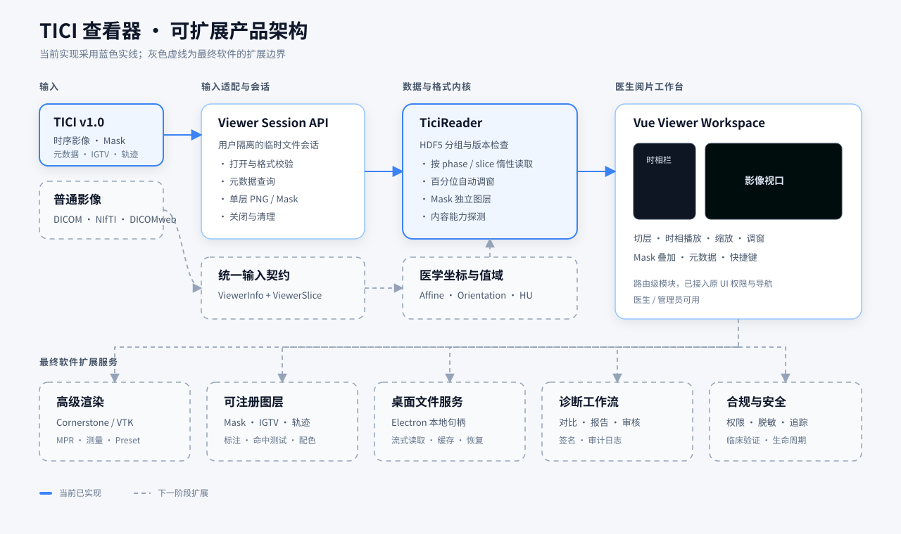

# TICI 查看器架构



## 目标

TICI 查看器是 LungTic 面向影像科医生的独立阅片入口。它直接检查时序影像和
TICI 封装内容，不创建患者、检查或序列记录，因此可安全用于文件验收、科研数据
核查和模型产物复核。

当前版本以轴位二维阅片为核心，覆盖：

- 多时相列表、缩略图和电影播放；
- 单层惰性读取、滚轮/键盘切层和缩放；
- 自动百分位窗宽窗位与手动调窗；
- 每时相 Mask 叠加和透明度控制；
- 患者、检查、体素间距、来源和内容能力核验。

## 数据流

```text
.tici 文件
    │  POST /api/tici/viewer/open
    ▼
当前用户的临时查看会话
    │  只读取元数据，不写患者数据库
    ├── GET /info ───────────────► 时相与封装元数据
    └── GET /slice?phase=&slice= ► 单张 PNG + 可选 Mask
                                      │
                                      ▼
                         Vue 查看器状态与图层渲染
```

关闭查看器时调用 `DELETE /api/tici/viewer/{viewer_id}` 清理临时文件。会话文件名
包含当前用户 ID，其他用户无法通过 viewer ID 读取该文件。

## 模块边界

| 层 | 文件 | 职责 |
|---|---|---|
| 页面编排 | `frontend/src/views/TiciViewer.vue` | 会话、快捷键、播放、调窗与工作台布局 |
| 图像视口 | `frontend/src/components/tici/TiciViewport.vue` | 基础影像与叠加层显示、缩放、加载状态 |
| 前端适配器 | `frontend/src/features/tici/api.ts` | TICI 查看 API 调用 |
| 类型契约 | `frontend/src/features/tici/types.ts` | 元数据、时相和切片响应类型 |
| HTTP 接口 | `backend/routers/tici.py` | 用户隔离的上传、元数据、切片与清理接口 |
| 格式读取 | `tici/tici_io.py` | HDF5/TICI 元数据和单层惰性读取 |

该拆分刻意让视口不依赖文件格式。以后支持普通 DICOM/NIfTI 时，只需实现同一份
查看数据契约，不必复制页面和交互。

## 面向最终软件的扩展顺序

1. **输入适配层**：新增 DICOM 文件夹、DICOMweb 和 NIfTI 适配器，统一输出
   `ViewerInfo` 与 `ViewerSlice`。
2. **医学坐标层**：在 TICI 中保存完整 affine、方向矩阵和像素值域，支持可靠的
   冠状位/矢状位 MPR、空间测量和 CT HU 预设窗。
3. **渲染层**：把当前 PNG 视口替换为 Cornerstone/VTK 渲染服务；页面状态和工具栏
   接口保持不变。
4. **图层系统**：将 Mask、IGTV、轨迹、标注实现为可注册 overlay，支持显隐、配色、
   透明度和命中测试。
5. **桌面文件服务**：Electron 环境使用本地文件句柄和流式读取，避免大型文件先上传
   到后端；浏览器版本仍保留当前临时会话协议。
6. **诊断工作流**：最后再接入序列对比、结构化报告、审核签名和审计日志，保持查看
   与正式入库两个动作明确分离。

## 当前边界

- 仅显示轴位切片；尚未实现 MPR、测量、DICOM 标签浏览和诊断报告。
- TICI v1.0 示例数据没有完整医学 affine 或明确的 HU 值域，因此自动调窗按当前切片
  的有限值百分位计算。
- 临时会话会在正常关闭页面时删除；正式部署还应增加服务端的超时清理任务。

这些边界不会阻塞当前的文件查看和格式核验，但在声明为临床诊断软件前，需要补齐
医学坐标、数据保真、审计、安全和法规验证。
